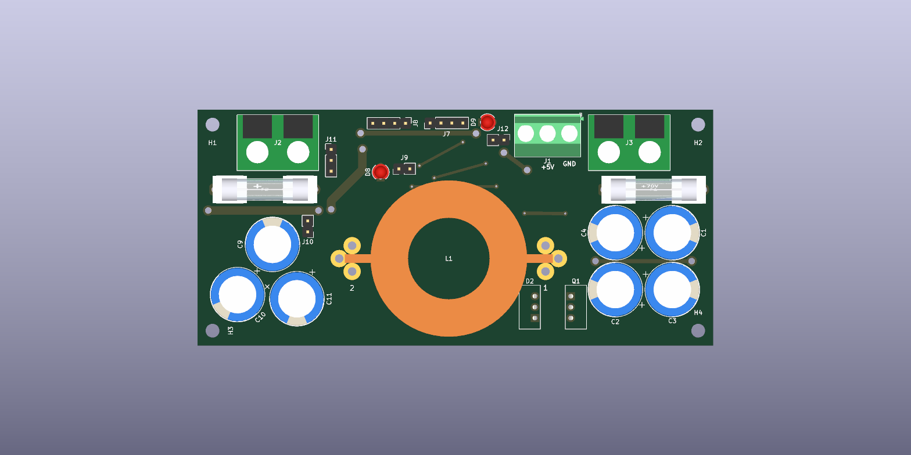
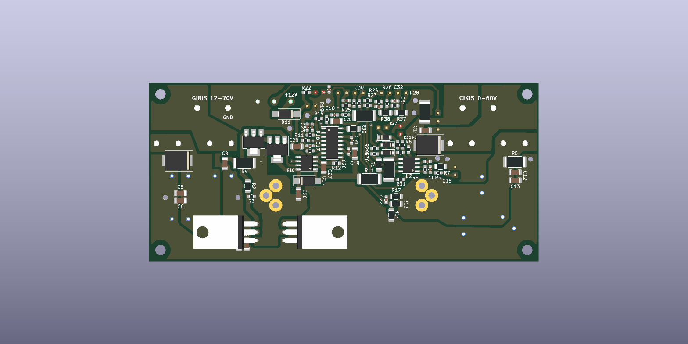

# Lab güç kaynağı buck modülü — 0,8–60 V / 0–10 A

TL494 denetleyicili, IR2101 üst kapı sürücülü, asenkron (diyotlu) **buck** dönüştürücü kartı.
Laboratuvar güç kaynağının güç katı olarak tasarlandı: ön paneldeki iki pot ile **gerilim (CV)** ve **akım (CC)** ayarlanır.
İki kanallı bir kaynak için aynı karttan iki adet kullanılabilir.

| | |
|---|---|
| Giriş | 12–70 V DC (60 V çıkış için giriş ≥ 68 V) |
| Çıkış | 0,8–60 V (CV), 0–10 A (CC); en fazla ≈ 300 W |
| Yardımcı besleme | harici +12 V (denetleyici, sürücü, fan) ve +5 V (panel ölçeri) |
| Anahtarlama | ≈ 80 kHz, IRF3710 üst anahtar, MBR20200CT serbest diyot |
| Akım ölçme | 10 mΩ şönt + LM2904, IMON çıkışı 0,2 V/A |
| Kart | 120 × 55 mm, **tek katman** (alt yüz bakır), 1,6 mm FR4 |
| Tasarım | KiCad 10 — şema, kart, kütüphaneler, Gerber ve BOM bu depoda |

## Devre
- **Kontrol:** TL494'ün iki hata yükselteci kullanılır: biri gerilim (CV), biri akım (CC) döngüsü. Tek uçlu mod (pin 13 = GND).
- **Kapı sürücü:** IR2101 yalnız üst çıkışıyla (HO) kullanılır; BCP56/BCP53 emitör izleyici tampon kapıyı ≈ 1 A tepe akımla sürer.
- **Bobin (L1):** iki adet KT130-26 toroid nüve üst üste, 26 tur, 2 × 1,0 mm emaye tel paralel (10 A altında ≈ 75 µH; sardıktan sonra ölçün).
- **Korumalar:**
  - giriş sigortası F1 (6,3 A gecikmeli) ve tek yönlü TVS D12: giriş ters bağlanırsa TVS iletir, F1 atar;
  - çıkış sigortası F2 (10 A) ve ters diyot D4: çıkışa ters akü bağlanırsa F2 atar;
  - hızlı aşırı akım kesmesi (≈ 12 A, karşılaştırıcı → DTC), yumuşak başlatma;
  - pot telleri koparsa ayar 0'a düşer (çıkış kapanır);
  - soğutucuya NC termostat girişi (J9).
- Asenkron yapı çıkıştan girişe akım basmaz; akü veya kondansatör bağlı çıkışta güvenlidir.
- Çıkış eksisi (OUT−) şönt üzerinden geçtiği için **şaseye bağlanmaz**; kanallar seri bağlanmaz.

Şemanın PDF'i: [uretim/lab_psu_buck_60v_sema.pdf](uretim/lab_psu_buck_60v_sema.pdf)

## Bağlantılar
| Konnektör | Pinler |
|---|---|
| J3 GİRİŞ 12–70 V | 1 = +, 2 = GND |
| J2 ÇIKIŞ 0–60 V | 1 = +, 2 = − |
| J1 yardımcı besleme | 1 = GND, 2 = +5 V, 3 = +12 V |
| J7 V POT, J8 I POT | 10 kΩ lineer pot; 3 ve 4 numaralı pinler pot GND ucuna **ayrı tellerle** (kopma algılama) |
| J9 TERMOSTAT | NC termostat (70 °C); kullanılmıyorsa köprüleyin |
| J10 IMON | 0,2 V/A akım çıkışı (panel ölçeri veya mikrodenetleyici) |
| J11 METRE | panel volt/ampermetresi: 1 = +5 V, 2 = ÇIKIŞ−, 3 = ÇIKIŞ+ |
| J12 FAN | 12 V fan |

## Kart ve montaj

- Bakır yalnız **alt yüzde**; evde (toner/lazer) veya tek katman sipariş olarak üretilebilir. SMD parçalar alt yüzde, THT parçalar üst yüzde.
- Üst yüzdeki (F.Cu) yollar ve vialar **tel atlamalarını** gösterir; Gerber'e F.Cu basılmaz:
  - 5 kalın GND teli (1,5 mm delik): ≈ 17, 22, 27, 26 ve 7 mm,
  - 4 ince sinyal teli (0,5 mm delik): SW ≈ 10 mm, VPOT_K ≈ 12 mm, DTC ≈ 20 mm, FB ≈ 12 mm.
- 0 Ω köprüler (R1, R37–R39 1206; R20, R21, R41 2512) SMD bölgesindeki yol geçişleridir.
- Q1 (IRF3710) ve D2 (MBR20200CT) kartın **altında yatık** durur; bacaklar 90° bükülür, sekmeler silikon ped + plastik burçla
  kart boyutundaki alüminyum plakaya bağlanır (sekmeler farklı potansiyelde, mutlaka izole edin). Plakanın üstüne SMD bölgesi için yalıtkan levha koyun.
- Güç yollarının maskesi açıktır; lehim ve bakır telle takviye edilebilir.

## Üretim dosyaları (`uretim/`)
| Dosya | İçerik |
|---|---|
| `lab_psu_buck_60v_gerber.zip` | Gerber (B.Cu, B.Mask, B.Paste, F/B.Silkscreen, Edge.Cuts) + delik dosyası |
| `gerber/` | aynı dosyalar açık hâlde |
| `BOM.csv` | malzeme listesi: üretici parça numarası, **Özdisan** ve **LCSC** stok kodları (`;` ayraçlı) |
| `BOM_JLCPCB.csv`, `CPL_JLCPCB.csv` | montajlı sipariş için LCSC kodlu BOM ve parça konum dosyası |
| `konum_alt_kicad.csv` | KiCad konum dosyası (alt yüz SMD) |
| `lab_psu_buck_60v_sema.pdf` | şema |

Stok kodları örnek olarak verilmiştir (Kasım 2026); sipariş öncesi stok ve fiyatı tedarikçiden kontrol edin.
Bazı Özdisan kodları stok durumuna göre seçilmiş **eşdeğer/muadil** parçalardır, `BOM.csv` "Not" sütununda belirtilmiştir:
- 1 µF 100 V kondansatörler (C5, C6, C7, C12, C13, C14, C33) için 0805 kılıf muadil: 1206 pedine ortalanarak lehimlenir.
- D12 için SMCJ100A (tek yönlü, aynı SMC kılıf). SMCJ85A bulunabiliyorsa o tercih edilir.
- 5×20 cam sigortaların **DC** anma değerini (≥ 80 V DC) veri sayfasından kontrol edin.

**Örnek maliyet (Kasım 2026, KDV ve kargo hariç):** kart üzerindeki malzemeler 1 kart için ≈ 12 USD,
10 kartlık alımda kart başına ≈ 8 USD. PCB, soğutucu, pot, panel ölçeri ve kasa hariçtir.

## KiCad
- KiCad 10 ile `lab_psu_buck_60v.kicad_pro` dosyasını açın.
- Karta özel semboller, footprint'ler ve 3D modeller `kutuphane/` altındadır (`lab_buck`); proje kütüphane tablosu bunları otomatik bulur.
  Diğer parçalar KiCad'in standart kütüphanelerindendir.
- Tasarım kuralları `lab_psu_buck_60v.kicad_dru` içindedir (hat ≥ 0,5 mm, dolgu–yol 1 mm, üst yüzde dolgu yok).
- DRC 0, ERC 0, şema–kart uyumu tam (Rev 0.4).

## İlk çalıştırma ve uyarılar
- Kartta **70 V DC'ye kadar** gerilim ve yüksek akım vardır. İlk denemeyi akım sınırlı bir kaynakla, düşük giriş geriliminde yapın.
- Önce yardımcı beslemeyi (+12 V) verip TL494 osilatörünü ve kapı sinyalini kontrol edin, sonra ana girişi yavaşça yükseltin.
- Kompanzasyon değerleri başlangıç değerleridir; tezgâhta yük basamağı ile doğrulanmalıdır. L1 endüktansını DC öngerilim altında ölçün.
- Q1 ve D2 soğutucusuz çalıştırılmamalıdır.

## Sürüm
**Rev 0.4** (Kasım 2026)

## Lisans
Bu donanım tasarımı **CERN Open Hardware Licence Version 2 – Permissive (CERN-OHL-P v2)** ile lisanslanmıştır, bkz. [LICENSE](LICENSE).

İzan Mekatronik — https://www.izanmekatronik.com.tr
